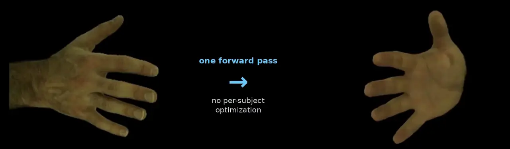

# InstantHand: Feed-Forward 3D Gaussian Splatting for Animatable Hand Avatar Reconstruction from a Single Image

**NeurIPS 2026**

[Chanho Kim](https://coolho1129.github.io),
[Muhammad Salman Ali](https://salmanali96.github.io/),
[Kyeonghwan Gwak](https://khgwak.github.io/about/),
[Muhammad Shaheryar](https://scholar.google.com/citations?user=v9FnXzwAAAAJ&hl=en),
[Incheol Park](https://github.com/inchulnim123),
[Jeongwan On](https://on-jungwoan.github.io/),
[Seungryul Baek](https://sites.google.com/site/bsrvision00/)<sup>*</sup>

[UNIST Vision & Learning Lab](https://vision.unist.ac.kr/), UNIST
&nbsp;&nbsp;<sup>*</sup> Corresponding author

<!-- Replace "(coming soon)" with a link to the first public version of the paper (OpenReview, arXiv, or proceedings) -->
**[Project Page](https://coolho1129.github.io/InstantHand-page/) | Paper (coming soon) | [Checkpoints](https://huggingface.co/coolho1129/InstantHand) | [Evaluation Data](https://github.com/coolho1129/InstantHand/releases/tag/v1.0)**

<p align="center">
  
</p>

From a single hand image, InstantHand builds an animatable 3D Gaussian hand avatar in 2.84 s, with no per-subject optimization.

## Quick start

```bash
git clone --recursive https://github.com/coolho1129/InstantHand.git
cd InstantHand
```

1. **Install** the environment and the CUDA extensions: [Installation](docs/INSTALL.md).
2. **Download** MANO and the full checkpoint (no DINOv3 request needed): [Files to download](docs/INSTALL.md#files-to-download).
3. **Run the demo** on the included examples:
   ```bash
   python demo.py --ids all
   ```
   Results are written to `demo/output/<name>/`. To use your own photo, see [Your own images](docs/DEMO.md#your-own-images).

Run every command from the repository root; config files and data paths are relative to it.

## Documentation

| Guide | Contents |
|---|---|
| [Installation](docs/INSTALL.md) | environment, CUDA extensions, files to download (MANO, checkpoints, DINOv3) |
| [Demo](docs/DEMO.md) | included examples, outputs, your own images, optional inference-time settings |
| [Evaluation](docs/EVAL.md) | InterHand2.6M and HanCo data preparation, metrics and options, efficiency |
| [Training](docs/TRAIN.md) | two-stage training, configs, training data layout |

## Results

| Benchmark | PSNR ↑ | SSIM ↑ | LPIPS ↓ |
|---|---|---|---|
| InterHand2.6M | 26.21 | 0.866 | 0.133 |
| HanCo (zero-shot) | 20.18 | 0.836 | 0.188 |

Avatar construction takes 2.84 s and rendering runs at 161 FPS on one A100.
How to reproduce these numbers and the other tables of the paper: [Evaluation](docs/EVAL.md).

## License

| Component | License |
|---|---|
| InstantHand code | [Apache-2.0](LICENSE) |
| Portions derived from [LAM](https://github.com/aigc3d/LAM) and [LHM](https://github.com/aigc3d/LHM) | Apache-2.0 |
| `diff-gaussian-rasterization/` (modified) | [Gaussian-Splatting License](diff-gaussian-rasterization/LICENSE.md) (Inria, non-commercial research use) |
| `instanthand/models/encoders/dinov3/` | [DINOv3 License](instanthand/models/encoders/dinov3/LICENSE.md) |
| `external/handavatar/` | [MIT](external/handavatar/LICENSE) |
| `external/handavatar/third_parties/lpips/` | [BSD](external/handavatar/third_parties/lpips/LICENSE) |
| Pretrained checkpoint | non-commercial research use; the DINOv3 backbone in the full checkpoint is under the DINOv3 License |
| MANO | not included; see the [MANO license](https://mano.is.tue.mpg.de/license.html) |

Because the rasterizer and the pretrained model are restricted to non-commercial research use,
the repository as a whole can only be used for non-commercial research.

## Acknowledgements

This codebase builds on [LAM](https://github.com/aigc3d/LAM) and [LHM](https://github.com/aigc3d/LHM),
and we thank their authors for releasing them. We also thank the authors of
[HandAvatar](https://github.com/SeanChenxy/HandAvatar) and [OHTA](https://github.com/zxz267/OHTA)
for their evaluation protocols and code,
[3D Gaussian Splatting](https://github.com/graphdeco-inria/gaussian-splatting) for the rasterizer,
[DINOv3](https://github.com/facebookresearch/dinov3) for the image encoder, and
[WiLoR](https://github.com/rolpotamias/WiLoR) and [SAM 3](https://github.com/facebookresearch/sam3)
for hand pose and mask estimation.

## Citation

If you find this work useful, please cite:

```bibtex
@inproceedings{kim2026instanthand,
  title     = {{InstantHand}: Feed-Forward {3D} {Gaussian} Splatting for Animatable Hand Avatar Reconstruction from a Single Image},
  author    = {Kim, Chanho and Ali, Muhammad Salman and Gwak, Kyeonghwan and Shaheryar, Muhammad and Park, Incheol and On, Jeongwan and Baek, Seungryul},
  booktitle = {Advances in Neural Information Processing Systems (NeurIPS)},
  year      = {2026}
}
```
